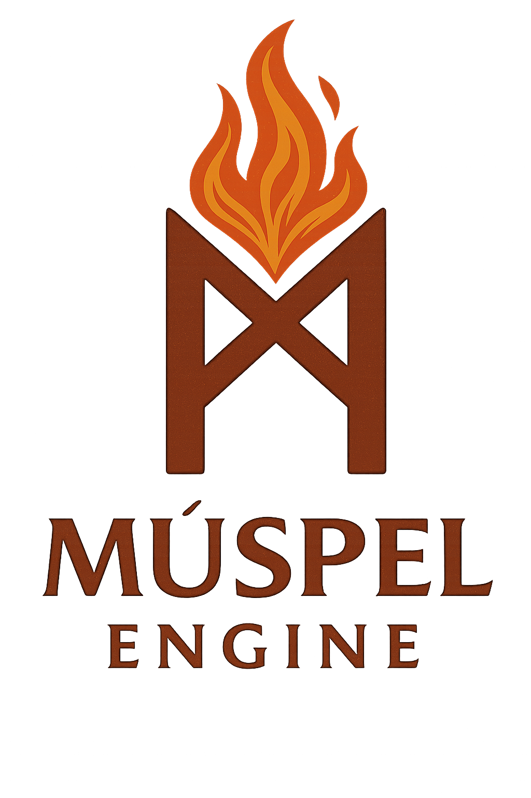

  

<h1 align="center">MÚSpel Engine</h1>

<em>Uit vuur wordt vorm geboren. Wat overbodig is, brandt weg. Wat overblijft, is perfectie.</em>

<em>From fire, form is born. What is superfluous burns away. What remains is perfection.</em>

---

## What Is MÚSpel?

The **MÚSpel Engine** is a proprietary, modular, high-performance infrastructure engine built in **C# (.NET 10)** with **C++** for native low-level modules. It is the foundation on which all Era Digital applications run.

The engine is **application-agnostic** — it provides system-level infrastructure only. It has no knowledge of what any application built on top of it actually does. Domain logic lives in the application, never in the engine.

MÚSpel is a commercial product in its own right. It is 100% Era Digital property — never co-owned, never shared.

---

## Architecture Philosophy

MÚSpel is inspired by Norse mythology. Every module is named after a Norse god or concept, and each name maps directly to a real system responsibility. This is not decoration — it is an architectural language.

The engine is built on two guiding principles:

**Windows native, Linux logic.**  
MÚSpel runs on Windows and uses Windows-native APIs where appropriate. But it is built with Linux discipline — lazy loading, minimal footprint, nothing runs until it is needed, no bloat.

**Independent and purposeful.**  
MÚSpel is not dependent on big tech platforms, always-online infrastructure, or cloud services for its core function. Where external services are the right tool — government APIs such as DigiD, PSD2 bank connectivity, Belastingdienst digital submission, or RDW — they are used purposefully and on Era Digital's terms. The engine keeps working through connection gaps. It is lightweight and independent by design, not by isolation.

---

## Core Design Principles

- **Modular and decoupled** — every module has a single responsibility and can evolve independently without breaking the core
- **Security first** — every secure operation flows through a layered security chain; applications never touch cryptography directly
- **Legally precise** — legally-operative acts are cryptographically signed, NTS-timestamped, and immutably recorded; security exists to protect the system, not to satisfy compliance checkboxes
- **OOP by design** — encapsulation, abstraction, and single responsibility are not imposed on the architecture; they emerge naturally from it
- **No bloat** — nothing runs until it is needed; nothing exists that does not earn its place

---

## The BAAS Ecosystem

**BAAS (Boosten Advanced Accounting Suite)** is the flagship application suite built on the MÚSpel Engine. It targets the Dutch financial administration market, serving accountants, auditors, and small business owners.

| Application | Platform | For |
|:---|:---|:---|
| **BAAS Certified** | Desktop | Accountants & Auditors |
| **BAAS CARE** | Android | Accountants — mobile companion |
| **BAAS LIQuidity** | Desktop | Business owners & entrepreneurs |
| **BAAS MADE** | Android | Entrepreneurs — mobile companion |

BAAS is co-developed with **Boosten Administraties** (Urmond, NL), a professional accountancy firm with expertise in Dutch fiscal law and small business administration.

---

## Technical Overview

| Property | Detail |
|:---|:---|
| **Primary language** | C# (.NET 10) |
| **Native modules** | C++ |
| **Compilation** | Native AOT — no JIT anywhere |
| **Platform** | Windows native |
| **Mobile** | Android via .NET MAUI |
| **Calculations** | F# modules (application-side) |
| **Repository** | github.com/EradicationGod/EraDigital_Svartalfheim |

---

## Current Status

The engine is in active development. Phase 1 (System Core) is in progress. The engine boots cleanly and runs at minimal resource usage. Active development follows a disciplined, incremental approach — each component is fully understood and tested before the next is built.

---

## Documentation

Full technical documentation is maintained in the `/Documentation` folder of this repository, following the Era Digital documentation system. All documents are in English and follow the `ED-[MAIN]-[SUB]-[NNN]` reference format.

---

## Ownership & Philosophy

**Owner:** Eric Slangen — Era Digital  
**© 2025–2026 Era Digital. All rights reserved.**  
Closed source. Proprietary. All intellectual property belongs exclusively to Era Digital.

> *"Een engine moet niet groot zijn om krachtig te zijn.*  
> *Hij moet weten wat hij níet hoeft te doen."*
>
> *"An engine does not need to be large to be powerful.*  
> *It needs to know what it does not have to do."*
